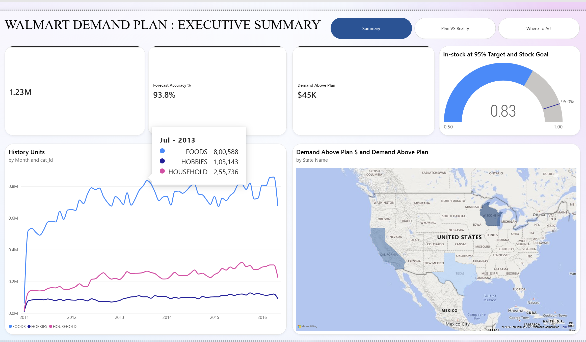
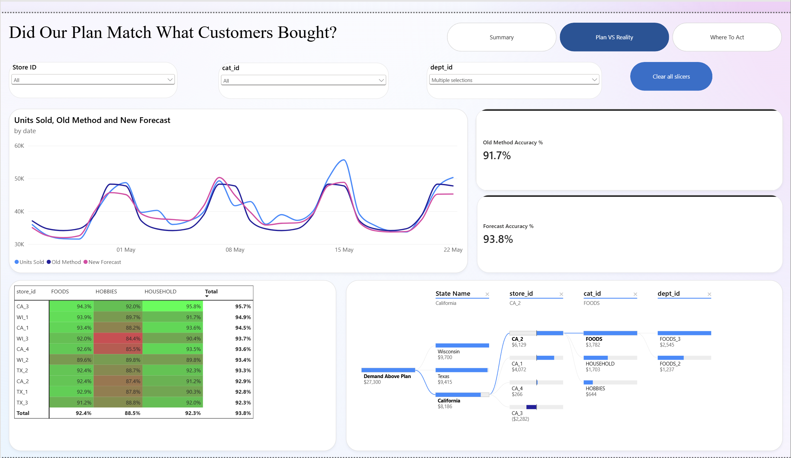
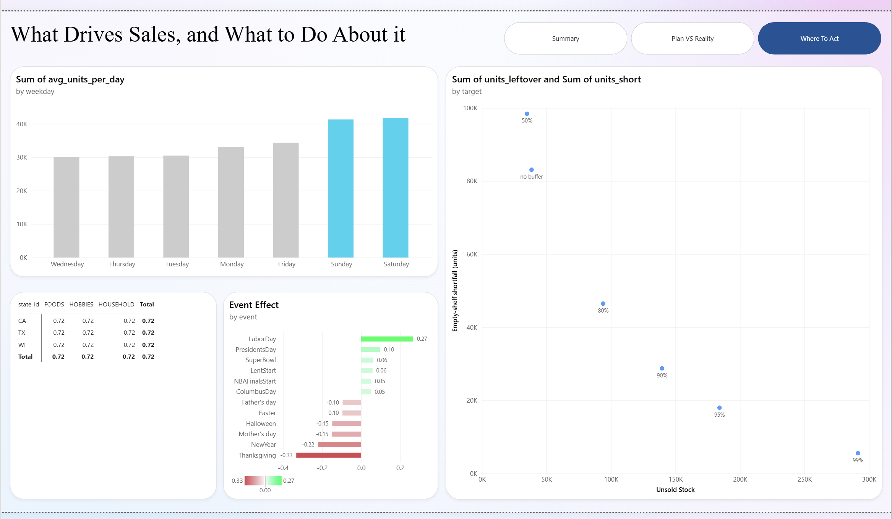

# Retail Demand Forecasting (M5 / Walmart)

Forecasting daily product demand across 10 Walmart stores using the M5
dataset. Built as a layered data pipeline in Python and DuckDB, followed by
exploratory analysis, forecasting models, a safety-stock analysis and a
Power BI dashboard.

**Tools:** Python, DuckDB (SQL), pandas, NumPy, LightGBM, Power BI

## Dashboard

A three-page Power BI report (`DA_02.pbix`) built on the exports in
`data/powerbi`.

**1. Executive summary:** sales history by category, forecast accuracy,
demand above plan by state, and the in-stock rate achieved when stocking to a
95% target.

**2. Plan vs reality:** the new forecast against the old method and actual
sales over the 28-day test period, with accuracy by store and category and a
breakdown of where demand exceeded the plan.

**3. Where to act:** weekday pattern, event effects, and the trade-off
between unsold stock and empty-shelf shortfall at each in-stock target.

## Dataset

M5 Forecasting - Accuracy (Kaggle): 30,490 product-store series, 3 categories,
10 stores in CA, TX and WI, 1,941 days (2011-01-29 to 2016-05-22).
Raw files are not included in this repository; download them from
[Kaggle](https://www.kaggle.com/competitions/m5-forecasting-accuracy/data)
and place the five CSVs in `data/raw`.

## Pipeline

| Layer  | Location | Contents |
|--------|----------|----------|
| Raw    | `data/raw` | Original CSVs, never modified |
| Bronze | `data/bronze/retail_bronze.duckdb` | Faithful copies of each CSV as tables |
| Silver | `data/silver/retail_silver.duckdb` | `silver_sales`: one row per product, store and day (59.2M rows) with date and price |
| Gold   | `data/gold/retail_gold.duckdb` | Features, forecasts and model outputs |
| Power BI | `data/powerbi` | Aggregated CSVs used by the dashboard |

The DuckDB files are not in the repository (about 2 GB); the scripts below
rebuild them from the raw CSVs.

## Project structure

    src/
      ingestion/   audit raw CSVs, build and validate Bronze
      transform/   build and validate Silver
      analysis/    exploratory analysis (seasonality, growth, events, SNAP)
      features/    feature engineering for LightGBM
      models/      baselines, LightGBM models, ensemble
      reporting/   business-level evaluation, safety stock, Power BI export
    models/        trained LightGBM models
    data/powerbi/  dashboard data
    images/        dashboard screenshots

## How to run

    python -m venv .venv
    .\.venv\Scripts\python.exe -m pip install -r requirements.txt

    # Phase 1-2: Bronze and Silver
    .\.venv\Scripts\python.exe .\src\ingestion\audit_csvs.py
    .\.venv\Scripts\python.exe .\src\ingestion\build_bronze.py
    .\.venv\Scripts\python.exe .\src\ingestion\validate_bronze.py
    .\.venv\Scripts\python.exe .\src\transform\build_silver.py
    .\.venv\Scripts\python.exe .\src\transform\validate_silver.py

    # Phase 3: Exploration
    .\.venv\Scripts\python.exe .\src\analysis\explore_sales.py
    .\.venv\Scripts\python.exe .\src\analysis\test_growth.py
    .\.venv\Scripts\python.exe .\src\analysis\events_snap.py

    # Phase 4: Baselines
    .\.venv\Scripts\python.exe .\src\models\baselines.py
    .\.venv\Scripts\python.exe .\src\models\weekday_model.py
    .\.venv\Scripts\python.exe .\src\models\trend_model.py

    # Phase 5: Machine learning
    .\.venv\Scripts\python.exe .\src\features\build_features.py
    .\.venv\Scripts\python.exe .\src\models\train_lgbm.py
    .\.venv\Scripts\python.exe .\src\features\build_origin_features.py
    .\.venv\Scripts\python.exe .\src\models\train_lgbm_v2.py
    .\.venv\Scripts\python.exe .\src\models\ensemble.py

    # Phase 6: Business view and dashboard data
    .\.venv\Scripts\python.exe .\src\reporting\business_view.py
    .\.venv\Scripts\python.exe .\src\reporting\safety_stock.py
    .\.venv\Scripts\python.exe .\src\reporting\export_powerbi.py

## Data quality

- All keys unique and non-null in every Bronze table; no duplicate price keys.
- Silver reconciles exactly with Bronze: 66,927,173 units in both.
- 20.78% of product-days have no price (product not yet launched); none of
  these have sales.
- Known anomaly: a few items show a $0.01 price in isolated weeks, likely data
  errors. Documented, not modified.

## Key findings

1. **Category mix:** FOODS is 68.6% of units but 58.0% of revenue
   (avg $2.42/unit vs $3.87 for HOUSEHOLD).
2. **Weekly rhythm:** Saturday averages 38% more sales than Wednesday.
3. **Censored demand:** Stores are closed on Christmas; pre-launch days show
   zero sales. Both are "no availability", not "no demand", and are excluded
   from modelling.
4. **Growth came from catalogue expansion:** From 2011 to 2016 (Feb-Apr
   comparison) products on the shelf rose 127% while sales per product fell
   26%. Expansion was complete by 2016, when per-product sales began rising.
5. **SNAP:** Food-assistance days lift FOODS by 10% (CA), 15% (TX) and 30%
   (WI), with only a 2-4% lift in non-food categories (control test passed).
6. **Holidays shift demand earlier:** Thanksgiving (-33%) and New Year (-22%)
   are low on the day itself; Labor Day (+27%) is high but partly confounded
   with early-month SNAP timing.

## Forecasting results

28-day holdout (2016-04-25 to 2016-05-22), 853,720 product-day forecasts.
Every model is scored on exactly the same rows.

| Model | MAE | RMSE | Bias |
|-------|-----|------|------|
| Zero forecast | 1.443 | 3.916 | -100.0% |
| Naive (last day) | 1.373 | 2.894 | +13.2% |
| Seasonal naive (last week) | 1.244 | 2.677 | -7.4% |
| 28-day moving average | 1.066 | 2.243 | -3.9% |
| 28-day average x pooled weekday profile | 1.048 | 2.191 | -3.9% |
| ...plus damped trend (rejected) | 1.050 | 2.193 | -3.5% |
| ...plus full trend (rejected) | 1.052 | 2.198 | -3.1% |
| LightGBM v1 (lags relative to target day) | 1.066 | 2.207 | -2.5% |
| **LightGBM v2 (origin-based features)** | **1.043** | **2.138** | **-3.6%** |

From seasonal naive to LightGBM v2: MAE -16.2%, RMSE -20.1%.

## Safety stock

A forecast is a mean, so stocking exactly to it runs out about half the time.
For each department, a buffer was learned on the validation month as a
quantile of the actual-to-forecast ratio, then applied to the test month.

| In-stock target | Achieved (validation) | Achieved (test) | Extra stock | Units short | Units left over |
|-----------------|-----------------------|-----------------|-------------|-------------|-----------------|
| No buffer | 56.4% | 41.0% | 0.0% | 83,107 | 38,465 |
| 80% | 80.0% | 64.0% | +7.8% | 46,519 | 94,010 |
| 90% | 90.0% | 76.2% | +13.1% | 28,783 | 139,616 |
| **95%** | **95.0%** | **83.3%** | **+17.8%** | **18,006** | **184,147** |
| 99% | 98.9% | 92.9% | +27.8% | 5,527 | 291,440 |

- At the 95% target, 17.8% extra stock cuts empty-shelf shortfall by 78%
  (83,107 to 18,006 units) and keeps shelves stocked on 83% of
  department-store-days.
- Every target falls 6-16 points short on the test month because the model
  under-forecasts that month by 3.6%. Buffers learned from one month need a
  margin, or regular recalibration.

## Modelling lessons

- **Pool patterns, apply them to items.** A weekday profile learned from each
  store and category beat copying each product's own last week, because
  single-product sales are dominated by noise.
- **Trend adjustment was rejected.** It improved total bias but worsened daily
  accuracy. Store trends cancelled out, and on mostly-zero items a higher
  forecast adds error on every zero day.
- **LightGBM v1 lost to the baseline.** Its leakage-safe 28-day lags were
  measured from the target day, so early test days used data up to four weeks
  staler than the baseline's.
- **LightGBM v2 fixed this with origin-based features.** Twelve backtest
  origins for training, one for validation and one for test; every feature is
  computed as of the forecast date, with the baseline forecast included as a
  feature (verified identical to the weekday model on all 853,720 test rows).
  It beat the baseline by 2.4% RMSE, most of all in FOODS (-2.8%).
- **The objective shapes the metric.** The Tweedie objective targets the mean,
  so RMSE improved far more than MAE.

## What I learned

- DuckDB handled 59M rows on a laptop because it stores data by column, which
  suits analytical queries better than Excel (1M-row limit) or pandas
  (memory-bound).
- DuckDB fits single-machine analytics, but apps with many simultaneous users
  need PostgreSQL, and company-scale data needs a cloud warehouse.
- No single metric is enough: the zero forecast had the best MAE for HOBBIES,
  but bias (-100%) and RMSE exposed it as useless.
- A simple, well-designed baseline is hard to beat. LightGBM only won after
  its features were built from the forecast date, the same information the
  baseline had.
- A service-level target set on past data is not a guarantee: the 95% target
  delivered 83% on unseen data.

## Next steps

- Investigate the remaining -3.6% under-forecast (likely yearly seasonality)
- More training origins (weekly instead of every 28 days)
- Recalibrate safety-stock buffers on a rolling window
